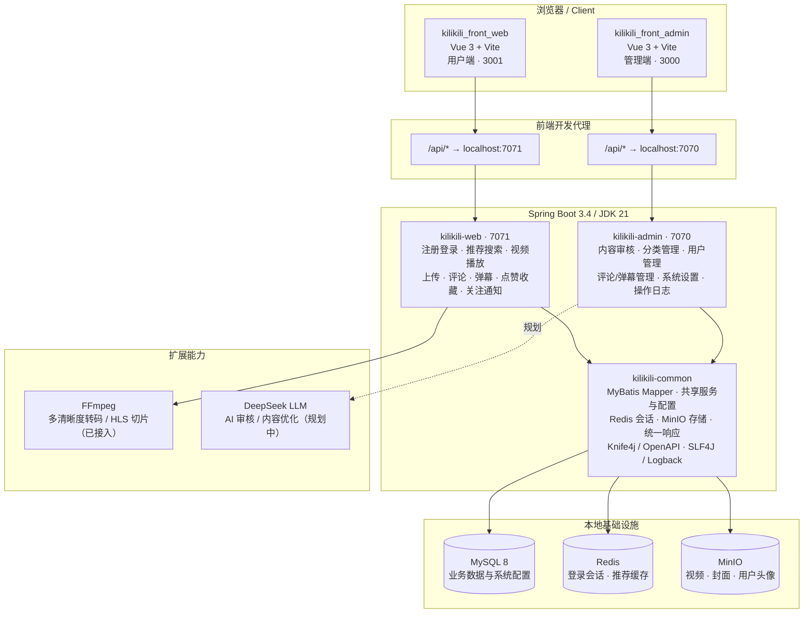

# KiliKili

仿 B 站的视频社区项目骨架，采用 Vue 3 + Spring Boot 多模块架构。

详细的数据模型、状态机、接口清单与迁移顺序见 [数据库与接口设计](docs/database-api-design.md)。

## 技术架构



### 请求链路

1. 用户端和管理端分别通过 Vite 的 `/api/*` 代理访问对应的 Spring Boot 服务。
2. 两个后端模块复用 `kilikili-common` 中的认证、存储、数据库访问、统一响应、日志和接口文档能力。
3. MySQL 保存用户、视频、互动、审核及系统配置；Redis 保存登录会话并缓存推荐结果；MinIO 保存视频、封面和头像。
4. FFmpeg 转码流水线已接入用户端（见下文），DeepSeek AI 审核仍为规划中的扩展点。

## 项目结构

| 目录 | 用途 | 端口 |
| --- | --- | --- |
| `kilikili-web` | 用户端 API | 7071 |
| `kilikili-admin` | 管理端 API | 7070 |
| `kilikili-common` | 两端共享的领域模型、统一响应和配置 | - |
| `kilikili_front_web` | 用户端 Vue 应用 | 3001 |
| `kilikili_front_admin` | 管理端 Vue 应用 | 3000 |

## 前置条件

- JDK 21
- Maven 3.9+
- Node.js 20+
- 本地运行的 MySQL 8、Redis 和 MinIO

## 启动

```powershell
mvn clean package
mvn -pl kilikili-web -am spring-boot:run
mvn -pl kilikili-admin -am spring-boot:run
```

分别在两个前端目录安装并启动：

```powershell
npm.cmd install
npm.cmd run dev
```

管理端使用具备 `ADMIN` 角色的账号密码登录。首次启动时，可通过以下环境变量创建一个管理员账号（请替换示例密码）：

```powershell
$env:ADMIN_BOOTSTRAP_USERNAME = "admin"
$env:ADMIN_BOOTSTRAP_PASSWORD = "replace-with-a-strong-password"
mvn -pl kilikili-admin -am spring-boot:run
```

然后启动 `kilikili_front_admin`，用该账号登录。初始化仅在账号不存在时创建，不会覆盖已有账号。

服务检查地址：`http://localhost:7071/api/health`、`http://localhost:7070/api/health`。

默认连接地址为 MySQL `localhost:3306/kilikili`、Redis `localhost:6379`、MinIO `localhost:9000`。可通过以下环境变量匹配你的本地账号与地址：`MYSQL_URL`、`MYSQL_USERNAME`、`MYSQL_PASSWORD`、`REDIS_HOST`、`REDIS_PORT`、`MINIO_ENDPOINT`、`MINIO_ACCESS_KEY`、`MINIO_SECRET_KEY`、`MINIO_BUCKET`。

`docker-compose.yml` 仅作为没有本地中间件时的备用开发环境，不需要执行。

## 用户端核心接口

| 接口 | 说明 |
| --- | --- |
| `POST /api/auth/register` | 注册并返回 Redis 会话 Token |
| `POST /api/auth/login` | 登录并返回 Token |
| `GET /api/videos` | 获取已发布的视频列表 |
| `POST /api/videos/upload` | 上传视频，需 `Authorization: Bearer <token>` |
| `GET /api/videos/{id}` | 获取播放用的 MinIO 临时地址 |
| `POST /api/videos/{id}/like` | 点赞/取消点赞 |
| `GET/POST /api/videos/{id}/comments` | 获取/发布评论 |
| `GET /api/videos/{id}/stream/master.m3u8` | HLS 主播放列表（转码完成后） |
| `POST /api/videos/{id}/transcode` | 作者重新发起转码 |

## 视频转码流水线

上传视频后自动创建 `transcode_task` 异步任务，由后台轮询执行：

1. 从 MinIO 下载原片，ffprobe 识别源分辨率；
2. 通过 Docker 调用 FFmpeg（默认镜像 `mwader/static-ffmpeg`，需先 `docker pull mwader/static-ffmpeg`）转出多清晰度 HLS 切片（480p/720p/1080p，按源分辨率自动裁剪档位）；
3. 切片回传 MinIO；播放时优先返回 HLS 地址，切片请求经 302 跳转到 MinIO 临时地址，转码未完成时回退原片直链。

任务失败自动重试（默认 3 次），服务重启后运行中的任务自动恢复排队。前端使用 hls.js 自适应播放。相关配置见 `kilikili-web/src/main/resources/application.yml` 的 `kilikili.transcode`，`executor` 支持 `docker`（默认）与 `direct`（直接调用宿主机 ffmpeg 二进制）两种方式。

## 管理后台

管理端地址为 `http://localhost:3000`，后端为 `http://localhost:7070`。先调用 `POST /api/admin/auth/login` 获取 Token；所有管理 API 都要求 `Authorization: Bearer <token>`，并验证该账号具有 `ADMIN` 角色：

| 接口 | 说明 |
| --- | --- |
| `GET /api/admin/dashboard` | 用户、视频、待审核与评论统计 |
| `GET/PATCH /api/admin/users` | 查询用户、启用或禁用用户 |
| `GET/PATCH /api/admin/videos` | 查询视频、审核通过、驳回或下架 |

用户被禁用后不能再次登录；视频审核为 `PUBLISHED` 后才会出现在用户端。

应用首次连接 MySQL 时会创建业务表；也可以手动执行 [sql/schema.sql](sql/schema.sql)。上传的视频默认为 `PENDING_REVIEW`，只有在管理端审核为 `PUBLISHED` 后才会出现在用户端列表和可播放。

## 日志

项目使用 Spring Boot 内置的 SLF4J + Logback。默认同时输出到控制台和 `logs/<服务名>.log`，按天和 20MB 分卷，保留 30 天。可用 `LOG_PATH` 改变日志目录，使用 `KILIKILI_LOG_LEVEL=DEBUG` 打开项目调试日志。

## 接口文档

启动用户端后端后访问 `http://localhost:7071/doc.html` 打开 Knife4j 文档。需要登录的接口，先调用登录接口复制 `token`，再在右上角 Authorize 中填写 `Bearer <token>`。
