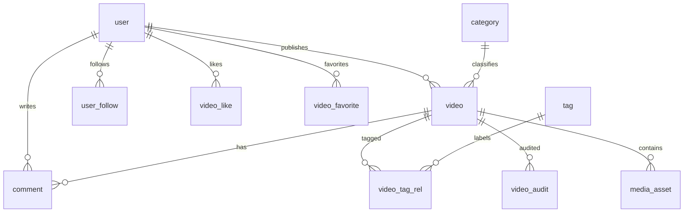
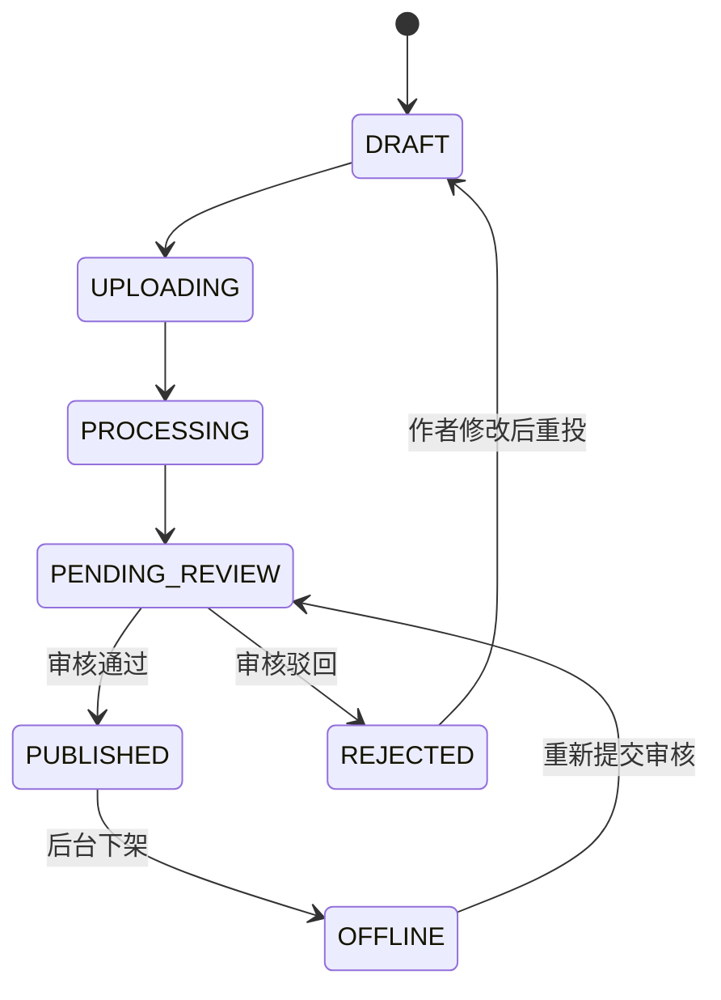

# KiliKili 数据库与接口设计（v1）

本文是下一阶段的目标设计，用于在现有 `account`、`video`、`video_like`、`video_comment` 表基础上逐步演进；不是可直接重复执行的迁移脚本。

## 设计约定

- 主键统一为 `BIGINT UNSIGNED`；接口以字符串返回 ID，避免 JavaScript 精度丢失。
- 业务表统一拥有 `created_at`、`updated_at`；需要保留历史的表增加 `deleted_at`，不物理删除。
- 金额、时长不用浮点数：时长以秒存 `INT UNSIGNED`，文件大小以字节存 `BIGINT UNSIGNED`。
- 状态字段使用 `VARCHAR(24)`，由应用层枚举约束，便于审核与运营状态扩展。
- 所有时间采用 UTC 存储、ISO-8601 返回；前端按用户时区展示。

## 核心关系



## 表设计

### 账号与权限

| 表 | 关键字段 | 说明 |
| --- | --- | --- |
| `user` | `id, username, password_hash, nickname, avatar_url, bio, status, last_login_at` | 用户主体。`status`: `ACTIVE` / `DISABLED` / `BANNED`。 |
| `role` | `id, code, name` | `USER`、`ADMIN`、`AUDITOR` 等角色。 |
| `user_role` | `user_id, role_id` | 用户—角色多对多；以联合主键去重。 |
| `permission` | `id, code, name` | 细粒度后台权限，例如 `video:audit`。 |
| `role_permission` | `role_id, permission_id` | 角色—权限多对多。 |
| `user_follow` | `follower_id, followee_id, created_at` | 联合主键 `(follower_id, followee_id)`；禁止自己关注自己。 |

现阶段的 `account.role` 可继续保留作为过渡字段。开始支持多个后台角色时，再迁移到 `role` / `user_role`。

建议索引：`user(username)` 唯一、`user(status, created_at)`、`user_follow(followee_id, created_at)`。

### 视频与媒体

| 表 | 关键字段 | 说明 |
| --- | --- | --- |
| `category` | `id, parent_id, name, slug, sort_order, status` | 分区树，例如动画、音乐、知识；`parent_id=0` 为一级分区。 |
| `tag` | `id, name, use_count, status` | 标签名称唯一，`use_count` 为冗余计数。 |
| `video` | `id, author_id, category_id, title, description, cover_asset_id, status, visibility, published_at` | 视频业务主体。`status`: `DRAFT` / `UPLOADING` / `PROCESSING` / `PENDING_REVIEW` / `PUBLISHED` / `REJECTED` / `OFFLINE`；`visibility`: `PUBLIC` / `UNLISTED` / `PRIVATE`。 |
| `media_asset` | `id, owner_id, bucket, object_key, media_type, mime_type, size_bytes, duration_seconds, width, height, checksum, status` | 原视频、HLS 播放列表、封面、字幕均放这里。`object_key` 唯一。 |
| `video_asset_rel` | `video_id, asset_id, purpose, sort_order` | `purpose`: `SOURCE` / `HLS` / `COVER` / `SUBTITLE`。可替换目前 `video.object_key`。 |
| `video_tag_rel` | `video_id, tag_id` | 联合主键；标签关联。 |
| `video_audit` | `id, video_id, auditor_id, result, reason, ai_score, ai_detail, created_at` | 人工与 AI 审核留痕；`result`: `PASS` / `REJECT` / `OFFLINE`。 |
| `video_stat` | `video_id, view_count, like_count, favorite_count, comment_count, share_count, updated_at` | 高频计数独立存放，避免热更新锁住 `video` 主行。 |
| `transcode_task` | `id, asset_id, video_id, status, attempt_count, error_message, started_at, finished_at` | FFmpeg 异步转码任务。 |

建议索引：

- `video(status, visibility, published_at DESC)`：首页/分区流。
- `video(author_id, created_at DESC)`：个人投稿页。
- `video(category_id, status, published_at DESC)`：分区页。
- `media_asset(object_key)` 唯一，`media_asset(checksum, size_bytes)`：去重候选。
- `video_audit(video_id, created_at DESC)`、`transcode_task(status, created_at)`：审核与任务消费。

### 互动与消息

| 表 | 关键字段 | 说明 |
| --- | --- | --- |
| `video_like` | `user_id, video_id, created_at` | 保留现有联合主键设计。 |
| `favorite_folder` | `id, user_id, name, visibility, created_at` | 收藏夹；每位用户有一个默认收藏夹。 |
| `video_favorite` | `folder_id, video_id, user_id, created_at` | `user_id` 冗余以支持按用户查询和权限校验。 |
| `comment` | `id, video_id, user_id, root_id, parent_id, content, status, like_count, reply_count, created_at` | 一级评论 `root_id=0,parent_id=0`；回复保留根评论 ID。`status`: `VISIBLE` / `PENDING` / `HIDDEN` / `DELETED`。 |
| `comment_like` | `user_id, comment_id, created_at` | 评论点赞。 |
| `notification` | `id, recipient_id, actor_id, type, target_type, target_id, is_read, created_at` | 关注、点赞、回复、审核通知。 |
| `operation_log` | `id, operator_id, module, action, target_type, target_id, detail_json, ip, created_at` | 后台审核、禁用等不可抵赖的操作审计。 |

建议索引：`comment(video_id, root_id, created_at DESC)`、`comment(parent_id, created_at)`、`notification(recipient_id, is_read, created_at DESC)`、`operation_log(target_type, target_id, created_at DESC)`。

## 计数与一致性

- 点赞、收藏、评论写入时先依赖联合唯一键保证幂等，再通过事务更新 `video_stat`。
- Redis 只作为计数累加缓冲与排行榜，不是最终事实来源；定时任务批量回写 MySQL。
- `video.view_count` 应改为 `video_stat.view_count`，用 Redis 的 UV 去重（如按天 `video:uv:{videoId}:{date}`）后异步汇总。
- 审核状态只能由后台状态机改变，不能由用户端传入 `PUBLISHED`。

## API 规范

### 通用约定

基础前缀为 `/api/v1`；当前 `/api` 可在兼容期内继续提供。统一响应：

```json
{ "code": 0, "message": "success", "data": {}, "timestamp": "2026-08-01T12:00:00Z" }
```

需要认证的接口使用 `Authorization: Bearer <token>`。列表统一请求 `page`（从 1 开始）与 `pageSize`（最大 50），响应：

```json
{ "items": [], "page": 1, "pageSize": 20, "total": 0, "hasMore": false }
```

所有写操作支持 `Idempotency-Key` 请求头，尤其是上传完成、点赞、收藏和审核；服务端保存最近 24 小时的处理结果。

### 用户端接口

| 方法 | 路径 | 权限 | 说明 |
| --- | --- | --- | --- |
| `POST` | `/auth/register` | 匿名 | 注册；用户名、密码、昵称。 |
| `POST` | `/auth/login` | 匿名 | 登录，返回 access token 与用户摘要。 |
| `POST` | `/auth/logout` | 登录 | 删除 Redis 会话。 |
| `GET` | `/users/me` | 登录 | 当前用户资料。 |
| `PATCH` | `/users/me` | 登录 | 修改昵称、简介、头像。 |
| `GET` | `/users/{id}` | 匿名 | 用户公开主页。 |
| `POST/DELETE` | `/users/{id}/follow` | 登录 | 关注/取消关注。 |
| `GET` | `/videos` | 匿名 | 推荐流；支持 `categoryId`、`tagId`、`sort`。 |
| `POST` | `/videos/upload-intents` | 登录 | 创建直传意图，返回 MinIO 预签名地址与 `assetId`。 |
| `POST` | `/videos` | 登录 | 基于上传完成的 `assetId` 创建草稿/投稿。 |
| `PATCH` | `/videos/{id}` | 作者 | 编辑草稿或待审核前内容。 |
| `POST` | `/videos/{id}/submit` | 作者 | 提交审核。 |
| `GET` | `/videos/{id}` | 匿名 | 详情与可播放地址；权限由可见性和状态决定。 |
| `POST/DELETE` | `/videos/{id}/like` | 登录 | 点赞/取消点赞，分别返回当前状态。 |
| `POST/DELETE` | `/videos/{id}/favorites/{folderId}` | 登录 | 收藏/取消收藏。 |
| `GET` | `/videos/{id}/comments` | 匿名 | `rootId` 为空时取一级评论，否则取回复。 |
| `POST` | `/videos/{id}/comments` | 登录 | 发布评论；可带 `parentId`。 |
| `POST/DELETE` | `/comments/{id}/like` | 登录 | 评论点赞/取消点赞。 |

上传应优先采用“预签名直传 + 完成回调”，避免大文件经过 Spring Boot：

1. `POST /videos/upload-intents` 传文件名、MIME、大小、SHA-256。
2. 浏览器直接 PUT 到 MinIO 预签名 URL。
3. `POST /videos` 带 `assetId`、标题、分区、标签提交投稿。
4. 服务端创建 `transcode_task`，转码完成后进入 `PENDING_REVIEW`。

### 管理端接口

| 方法 | 路径 | 所需权限 | 说明 |
| --- | --- | --- | --- |
| `POST` | `/admin/auth/login` | 匿名 | 管理员账号密码登录。 |
| `GET` | `/admin/dashboard` | `dashboard:read` | 待审核量、内容与用户统计。 |
| `GET` | `/admin/users` | `user:read` | 支持状态、关键词、注册时间筛选。 |
| `PATCH` | `/admin/users/{id}/status` | `user:manage` | 启用、禁用、封禁；必须记录操作日志。 |
| `GET` | `/admin/videos` | `video:read` | 支持状态、分区、作者、时间范围筛选。 |
| `POST` | `/admin/videos/{id}/audit` | `video:audit` | 请求体 `{ "result":"PASS|REJECT", "reason":"..." }`。 |
| `POST` | `/admin/videos/{id}/offline` | `video:manage` | 下架并通知作者。 |
| `GET` | `/admin/audits` | `audit:read` | 查询审核历史与 AI 判定。 |
| `GET` | `/admin/operation-logs` | `audit:read` | 查询后台操作审计。 |

当前 `PATCH /api/admin/videos/{id}/status` 可作为兼容接口，后续替换为语义化的 `audit`、`offline` 接口，避免前端任意跳转状态。

## 状态机



## 迁移顺序

1. 为现有 `account` 补全 `role`、`status`，并在登录与后台接口中强制校验。
2. 给 `video` 增加 `category_id`、`visibility`、`published_at`、`updated_at`；新建 `video_audit` 与 `media_asset`。
3. 把视频二进制位置迁移至 `media_asset`，保留原 `object_key` 至全部视频完成迁移。
4. 新建 `video_stat`，双写并核对计数后再切换读路径。
5. 引入标签、收藏、关注、通知和 RBAC 表；最后移除 `account.role` 单角色字段。

每一步都应以版本化迁移（推荐 Flyway）交付，禁止修改已在生产执行过的初始化 SQL。
